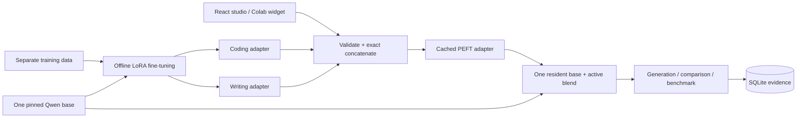

# Architecture and merge contract



For source adapter `i`, its contribution is `ΔW_i = (α_i/r_i) B_i A_i`. Given effective coefficients `w_i`:

```text
A* = concatenate(A_c, A_w; axis=0)
B* = concatenate(w_c α_c/r_c B_c, w_w α_w/r_w B_w; axis=1)
ΔW* = B* A* = w_c ΔW_c + w_w ΔW_w
```

The output adapter has alpha equal to its rank, so PEFT applies scale 1. Zero-weight sources are omitted. Two zero weights disable adapters entirely. Rank is the sum of active source ranks. Different ranks are supported; module inputs/outputs must agree. Floating-point results agree to normal float32 tolerance; this is algebraically exact, not a claim of infinite-precision arithmetic.

Normalization divides each coefficient by the sum, unless the sum is zero. With normalization off, each slider is a direct multiplier in `[0,1]`. Separately averaging A and B would introduce cross terms and is intentionally not used.

Compatibility checks require the same base ID, immutable 40-character revision, target modules, layer filters, exact tensor keys, and input/output dimensions. The training pipeline does not add tokens or train embeddings. Third-party adapters must honor that same tokenizer/vocabulary contract; metadata is an assertion of provenance, not cryptographic proof of how someone trained a model. Unsupported options are explicitly rejected.

Cache identity includes algorithm version, mode, base ID/revision, effective coefficients and SHA-256 of each source config+tensor file. Creating a recipe validates both source adapters even if one coefficient is zero. A cache hit avoids rewriting output weights, but still validates and hashes inputs. Export produces only the adapter, not full base weights. To use it elsewhere:

```python
from transformers import AutoModelForCausalLM, AutoTokenizer
from peft import PeftModel
base = AutoModelForCausalLM.from_pretrained(base_id, revision=base_commit)
model = PeftModel.from_pretrained(base, 'extracted-adapter-directory').eval()
tokenizer = AutoTokenizer.from_pretrained(base_id, revision=base_commit)
```

The engine loads the base once, retains a source PEFT wrapper, and replaces one active `blend` adapter as needed. A reentrant lock serializes warmup, adapter switching, and generation. There is one background job worker and at most three admitted queued/running jobs. Cancellation takes effect between generations. Direct interactive requests share the same engine lock. A slow benchmark occupies the GPU; it does not run variants concurrently.

SQLite uses WAL mode and independent connections. Recipes and runs persist, as do intermediate job rows. A restart marks previously running/queued jobs interrupted. Prompt text, settings, model provenance, and outputs are stored. API keys are not saved to database records. This is a single-user service with one shared API key; there is no per-user isolation.

The frontend has no embedded offline model: it talks to a backend in either explicit mode. Changing endpoints clears its current result state. Rehearsal outputs and metrics carry different provenance. No token rates, quality scores, or speedup claims are generated for canned fixtures.
